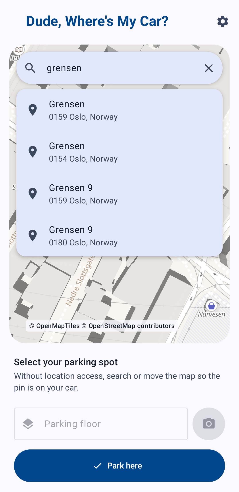

# Dude, Where's My Car?

A simple app for remembering where you parked your car.

## Features

- Find your parking spot with GPS in one tap, then fine-tune the pin on the map before saving it
- No GPS signal, or no location access? Search for an address and place the pin yourself
- Note which floor you parked on
- Take a photo of your car to help you find it, and view, retake or delete it any time
- See the address and when you parked
- Navigate back to your car with your favourite maps app
- Detailed map in both light and dark mode
- Light, dark or phone theme, built with Material Design 3

Your parking spot and photo are saved locally on your device and are not included in backups.

## Screenshots

  
  
  

## Download

Get the latest APK from the [Releases](../../releases) page.

Dude, Where's My Car? needs Android 16 or newer.

## Credits

- Map tiles from [OpenFreeMap](https://openfreemap.org/), using [OpenMapTiles](https://openmaptiles.org/). Map data © [OpenStreetMap contributors](https://www.openstreetmap.org/copyright), available under the [ODbL](https://opendatacommons.org/licenses/odbl/).
- Address search by [Photon](https://photon.komoot.io/) from komoot.
- Maps drawn with [MapLibre Native](https://maplibre.org/).

## License

Copyright (C) 2026 Zebra Software

This program is free software: you can redistribute it and/or modify it under the terms of the GNU General Public License as published by the Free Software Foundation, version 3.

This program is distributed in the hope that it will be useful, but WITHOUT ANY WARRANTY; without even the implied warranty of MERCHANTABILITY or FITNESS FOR A PARTICULAR PURPOSE. See the [LICENSE](LICENSE) file for details.
