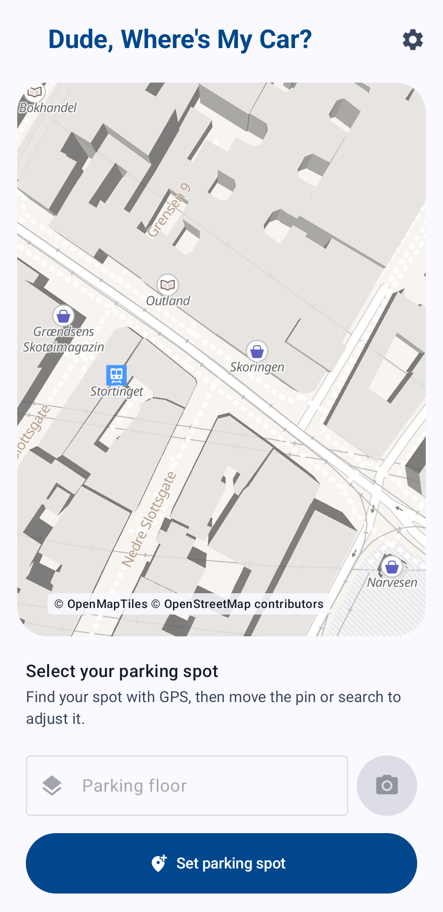
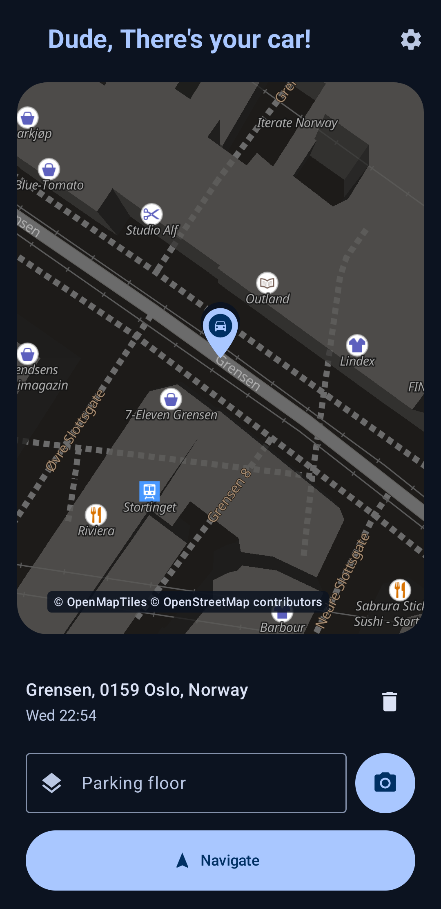

# Dude

A simple app for remembering where you parked your car. Dude, where's my car?

## Features

- Save your parking spot with GPS, or search for an address and place the pin yourself on the map. Works even with poor or no GPS.
- Note which floor you parked on
- See the address and when you parked
- Navigate back to your car with your favourite maps app
- Detailed map in both light and dark mode
- Light, dark or phone theme, built with Material Design 3

Your parking spot is saved locally on your device.

## Screenshots

  
  
  

## Download

Get the latest APK from the [Releases](../../releases) page.

Dude needs Android 16 or newer.

## Credits

- Map tiles from [OpenFreeMap](https://openfreemap.org/), using [OpenMapTiles](https://openmaptiles.org/). Map data © [OpenStreetMap contributors](https://www.openstreetmap.org/copyright), available under the [ODbL](https://opendatacommons.org/licenses/odbl/).
- Address search by [Photon](https://photon.komoot.io/) from komoot.
- Maps drawn with [MapLibre Native](https://maplibre.org/).

## License

Copyright (C) 2026 Zebra Software

This program is free software: you can redistribute it and/or modify it under the terms of the GNU General Public License as published by the Free Software Foundation, version 3.

This program is distributed in the hope that it will be useful, but WITHOUT ANY WARRANTY; without even the implied warranty of MERCHANTABILITY or FITNESS FOR A PARTICULAR PURPOSE. See the [LICENSE](LICENSE) file for details.
